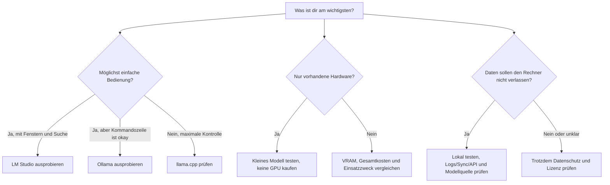

# Lokale KI Schritt für Schritt

Dieses Handbuch führt von der Auswahl eines Rechners bis zum ersten lokalen
Modell. Es richtet sich an private Anwenderinnen und Anwender; die Hinweise
sind bewusst konservativ gehalten. Modellbedarf und Kompatibilität hängen von
Software, Version, Hardware und Einstellungen ab.

## 🧭 Orientierung und Fortschritt

Arbeite die Schritte der Reihe nach durch oder springe direkt zum passenden
Thema. Die Kästchen sind eine persönliche Fortschrittsliste: Markiere beim
Lesen erledigte Schritte mit `[x]`, wenn du eine eigene Kopie pflegst.

- [ ] [1. Voraussetzungen und Warnhinweise](#1-voraussetzungen-und-warnhinweise)
- [ ] [2. Einsatzzweck und passender Weg](#2-den-einsatzzweck-festlegen)
- [ ] [3. Hardware auswählen](#3-hardware-auswählen)
- [ ] [4. Gesamtkosten berechnen](#4-gesamtkosten-transparent-rechnen)
- [ ] [5. Software auswählen](#5-software-auswählen)
- [ ] [6. Ersten Test starten](#6-einrichtung-erster-test-mit-ollama)
- [ ] [Anleitungen: Wenn du X machen willst](#anleitungen-wenn-du-etwas-bestimmtes-machen-willst)
- [ ] [7. Modell passend auswählen](#7-modell-passend-zur-hardware-wählen)
- [ ] [8. Mehrere Rechner (optional)](#8-mehrere-rechner-optional)
- [ ] [9. Ergebnis prüfen und Fehler beheben](#9-verifizieren-und-fehler-beheben)
- [ ] [10. Quellen und Aktualität](#10-quellen-und-aktualität)

**Farblegende:** 🟢 nächster Schritt / empfohlen · 🔵 Erklärung / Orientierung ·
🟡 prüfen / Vorsicht · 🔴 Sicherheitswarnung · ✅ erledigt

> **🔵 Kurz gesagt:** Für den Einstieg brauchst du keinen Spezialrechner.
> Installiere einen lokalen Modell-Runner, wähle ein Modell, dessen
> Gewichtsdatei in den verfügbaren Speicher passt, und teste es zunächst
> offline. Für die Hardwarewahl zählen verfügbarer VRAM/RAM, gewünschte
> Kontextlänge, GPU-Unterstützung und Gesamtbudget.

## 1. Voraussetzungen und Warnhinweise

> **🔴 Sicherheit zuerst:** Lade Software und Modelle nur aus vertrauenswürdigen
> Quellen. „Lokal“ allein garantiert weder Datenschutz noch eine passende
> Modelllizenz.

- Ein unterstütztes Betriebssystem (Windows, macOS oder Linux), freie
  SSD-Kapazität für Runner und Modelle sowie eine Verbindung für den
  Modelldownload.
- Ein normales Benutzerkonto genügt oft. Treiber oder Systemdienste können je
  nach Betriebssystem Administratorrechte erfordern. Lade Installationsdateien
  nur von der offiziellen Projektseite.
- Lokale Verarbeitung bedeutet nicht automatisch vollständige Vertraulichkeit:
  Chats, Logs, Telemetrie, Backups oder Sync-Software können Inhalte weiterhin
  speichern oder übertragen. Prüfe die Einstellungen der verwendeten Software.
- Beziehe Modellgewichte aus einer vertrauenswürdigen Quelle, prüfe Modellkarte
  und Lizenz und führe keine unbekannten Skripte oder „Installationshelfer“
  aus.
- Ein lokales Modell kann falsche oder erfundene Antworten geben. Verwende es
  nicht als alleinige Quelle für sicherheitskritische, medizinische, rechtliche
  oder finanzielle Entscheidungen.
- Große Modelle benötigen Speicherplatz, Strom und Kühlung. Achte auf
  Netzteil, Gehäusebelüftung und Herstellerangaben; öffne ein Netzteil nicht.
- „Lokal“ heißt nicht „für beliebige Nutzung lizenziert“. Lies die Lizenz des
  konkreten Modells und beachte deine Datenschutzpflichten.

## 2. Den Einsatzzweck festlegen

> **🟢 Aktueller Punkt:** Entscheide zuerst, was du mit der KI tun möchtest.
> Wenn du noch unsicher bist, starte mit einem kleinen Textmodell auf bereits
> vorhandener Hardware und gehe danach zu [Schritt 3](#3-hardware-auswählen).

| Einsatz | Sinnvoller Startpunkt | Worauf es besonders ankommt |
|---|---|---|
| Chat, Zusammenfassungen, einfache Hilfe | Kleines quantisiertes Modell | Genug freier Speicher, einfache Installation |
| Programmierhilfe, anspruchsvolleres Deutsch, Analyse | Größeres Modell oder bessere Quantisierung | VRAM/RAM, Kontextlänge, Qualität des konkreten Modells |
| Bilder verstehen oder erzeugen | Modell und Runner mit passender Bildfunktion | Unterstützter Workflow, VRAM und Speicherbedarf |
| Eigene Dokumente durchsuchen (RAG) | Chatmodell plus lokaler Index | Datenschutz, Importqualität, Embedding-Modell und Quellenanzeige |
| Viele parallele Nutzer oder Dauerbetrieb | Dedizierter Rechner/Server | Dauerlast, Kühlung, Wartung, Zugriffsschutz und Stromkosten |

Ein größeres Modell ist nicht zwangsläufig für jede Aufgabe besser. Vergleiche
einige Modelle mit deinen eigenen Beispielen, bevor du Hardware kaufst.

### Welcher Weg passt zu mir?



Die Auswahl ist ein Startpunkt, keine Bindung: Du kannst mit einem kleinen
Modell in einem Runner beginnen und später wechseln. Typische Fälle:

| Wenn du … | Nimm zuerst diesen Weg | Nicht vorschnell … |
|---|---|---|
| noch nie ein lokales Modell gestartet hast | ein kleines Modell in einer grafischen App ausprobieren | GPU kaufen, bevor du ein Modell getestet hast |
| eine einfache lokale API für ein eigenes Programm brauchst | Runner-Dokumentation zur lokalen API lesen und zunächst nur auf demselben Rechner testen | den API-Port im Heimrouter freigeben |
| nur gelegentlich Fragen stellst | vorhandene Hardware und ein kleines Modell testen | einen Server dauerhaft laufen lassen |
| häufig lange Dokumente analysierst | Kontextbedarf und RAM/VRAM mit einem konkreten Test prüfen | nur anhand der Modellparameterzahl kaufen |
| keine inkompatiblen Programme oder Treiber installieren möchtest | erst einen Runner wählen und dessen offizielle Voraussetzungen prüfen | mehrere Runner/Backends gleichzeitig auf Verdacht installieren |
| ein Bildmodell oder mehrere parallele Nutzer brauchst | gezielt den unterstützten Workflow und zusätzlichen Speicherbedarf recherchieren | die Textmodell-Faustregeln unverändert übernehmen |

## 3. Hardware auswählen

> **🟡 Vor dem Kauf prüfen:** Modellgröße, Kontext und Runtime brauchen
> zusätzlichen Speicher neben den Gewichten. Die folgenden Klassen sind
> Richtwerte, keine Kompatibilitäts- oder Leistungsgarantie.

### Speicher zuerst: VRAM, RAM und SSD

Beim Laden auf eine GPU müssen Modellgewichte in den verfügbaren VRAM passen.
Hinzu kommen Laufzeit- und KV-Cache-Speicher; längere Kontexte und parallele
Anfragen erhöhen den Bedarf. Ist das Modell zu groß, kann der Runner Teile im
Arbeitsspeicher (RAM) ausführen oder auslagern. Das kann funktionieren, ist aber
oft deutlich langsamer. Mehrere GPUs bilden nicht automatisch einen
gemeinsamen VRAM-Pool.

Die folgende Tabelle ist eine **grobe Planungs-Faustregel**, keine
Leistungszusage. Sie bezieht sich auf quantisierte Textmodelle und kurze bis
mittlere Kontexte; Bildmodelle, längere Kontexte und parallele Nutzer brauchen
zusätzlichen Speicher.

| Dedizierter GPU-Speicher (VRAM) | Grobe Modellklasse zum Ausprobieren | Einordnung |
|---:|---|---|
| 8 GB | ungefähr 3B–8B, niedrige Bitbreite | Für den Einstieg; größere Modelle oder lange Kontexte sind oft eng |
| 12 GB | ungefähr 7B–14B, quantisiert | Guter Einstieg in GPU-Inferenz, abhängig von Quantisierung und Kontext |
| 16 GB | ungefähr 8B–14B komfortabler | Mehr Reserve für Kontext und größere Varianten |
| 24 GB | ungefähr 20B–32B, quantisiert | Größere Modelle möglich; tatsächlichen Bedarf vorher prüfen |
| 48 GB oder mehr | größere Modelle, teils um 70B, quantisiert | Gewichte allein entscheiden nicht; Runtime und Kontext einrechnen |

**Warum nur eine Faustregel?** Bei einer 4-Bit-Quantisierung entsprechen die
Gewichte grob einem halben Byte pro Parameter. Dateiformat, Metadaten,
Quantisierungsverfahren, Runtime und KV-Cache verändern den realen Bedarf.
Die Dateigröße des konkreten Modells ist der bessere Startwert. Plane Reserve
ein, statt den VRAM bis zum letzten Byte zu verplanen. Bei CPU-Ausführung
zählen verfügbarer RAM und Speicherbandbreite. Antwortgeschwindigkeit hängt
zusätzlich von CPU, GPU, Treiber, Runner und Modell ab; Tokens-pro-Sekunde
lassen sich nur für genau dokumentierte Messungen sinnvoll vergleichen.

### Hardware-Empfehlungen nach Budget und Zweck

Die folgenden Angaben sind **Planungsklassen, keine Mindestanforderungen eines
bestimmten Modells oder Kaufempfehlung für eine konkrete Karte**. „Mindestziel“
heißt: ein sinnvoller Ausgangspunkt zum Ausprobieren. Modellgewichte,
Quantisierung, Kontextlänge, Bildfunktionen und Runtime verändern den Bedarf;
prüfe immer die Dateigröße und die Anforderungen des konkreten Modells.
Für jede Kategorie ist „empfohlen“ die angenehmere Reserve, kein
Kompatibilitätsversprechen.

| Kategorie | Mindestziel zum Ausprobieren | Sinnvolle Empfehlung | Typische Aufgaben und Grenzen |
|---|---|---|---|
| Vorhandenen PC weiterverwenden | 16 GB RAM, genügend freier SSD-Platz; CPU-Ausführung oder vorhandene kompatible GPU | 32 GB RAM; SSD mit freiem Platz für Runner plus mehrere Modell-Dateien; GPU nur dann nachrüsten, wenn der Runner sie unterstützt | Kleine quantisierte Textmodelle und kurze Tests. CPU-only funktioniert, kann aber je nach Prozessor und Modell langsam sein. |
| Kleines Budget / GPU-Einstieg | Eine kompatible GPU mit etwa 8 GB VRAM und mindestens 16 GB RAM | 12 GB oder mehr VRAM, 32 GB RAM und ausreichend SSD-Platz | Kleine bis mittlere quantisierte Textmodelle; bei 8 GB ist Kontext, Quantisierung und Runtime besonders knapp. |
| Ausgewogener Einzel-PC | Einzelne GPU mit etwa 12 GB VRAM, 32 GB RAM | 16–24 GB VRAM, 32–64 GB RAM und genügend SSD-Platz | Häufiger Chat, Zusammenfassungen und Programmierhilfe. Größere quantisierte Modelle können je nach konkreter Datei und Kontext passen; vor dem Kauf ausprobieren, statt allein Parameterzahlen zu vergleichen. |
| Leistungsstarke Workstation | Einzelne GPU mit mindestens etwa 24 GB VRAM, 32 GB RAM | 48 GB oder mehr VRAM, 64 GB oder mehr RAM, schneller ausreichend großer SSD-Speicher und stabile Kühlung | Größere quantisierte Modelle, längere Kontexte oder mehr parallele Aufgaben. Selbst viel VRAM garantiert nicht, dass jedes Modell/Format unterstützt wird; große Modelle können mehrere Karten oder CPU-Offload brauchen und langsamer sein. |
| Mehrere Rechner (optional) | Zwei Rechner mit jeweils unterstütztem Runner und Netzwerk; zunächst getrennt testen | Erst nach einem nachweisbaren Bedarf planen; Netzwerk, Leistungsaufnahme und Betriebsaufwand mitrechnen | Gut für getrennte Dienste oder mehrere Nutzer. Zwei Geräte addieren ihren VRAM nicht automatisch; Modellverteilung braucht explizite Unterstützung und kann zusätzliche Latenz bringen. |

Als grobe Orientierung können 8–12 GB VRAM für kleinere quantisierte Modelle,
16–24 GB für mehr Reserve bzw. manche mittlere Modelle und 48 GB oder mehr für
größere Modellvarianten sinnvoll sein. Das ist bewusst keine feste Zuordnung
„VRAM = Parameterzahl“: Ein Modell mit weniger Parametern kann wegen
Kontext-/Runtimebedarf trotzdem nicht passen, und eine stärkere Quantisierung
kann Qualität kosten. Mehrere GPUs teilen VRAM nur, wenn Software und
Modellformat das ausdrücklich unterstützen.

### Welche Komponente macht den größten Unterschied?

1. **VRAM:** Wichtigster Engpass für GPU-Inferenz. Mehr VRAM ermöglicht größere
   Gewichte oder mehr Reserve für Kontext und parallele Anfragen. Prüfe, ob
   Runner und Treiber die konkrete GPU unterstützen.
2. **System-RAM:** Hilft bei CPU-Ausführung, Offload und parallel laufenden
   Anwendungen. 32 GB sind ein vernünftiges Planungsziel für einen vielseitigen
   Einzel-PC; größere Workflows oder umfangreiche RAG-Indizes können mehr
   benötigen.
3. **GPU-Rechenleistung und Speicherbandbreite:** Beeinflussen, wie schnell
   Antworten erzeugt werden. Benchmarks sind nur mit gleicher Runtime,
   Modellvariante, Kontext und Testmethode vergleichbar.
4. **SSD:** Freier Platz ist für Runner, Modelle und Indexdaten entscheidend.
   Eine schnellere SSD kann das Laden großer Modelle verkürzen; sobald das
   Modell geladen ist, bestimmen vor allem Rechenleistung und Speicher die
   Antwortgeschwindigkeit.
5. **Netzteil, Gehäuse und Kühlung:** Prüfe Leistungsaufnahme, Anschlüsse,
   Abmessungen und die Netzteil-/Kühlungsvorgaben des Kartenherstellers.
   Hersteller-TDP ist weder der gemessene Gesamtverbrauch noch eine
   Stromkostenberechnung.

### Vorhandenen PC sinnvoll aufrüsten

Bevor du Komponenten kaufst:

1. Erfasse CPU, RAM, GPU und deren VRAM, freien SSD-Platz, Netzteilmodell,
   Gehäusegröße und Betriebssystem. Verwende Herstellerangaben oder
   Systeminformationen statt einer Schätzung.
2. Wähle eine konkrete Modell-Datei und prüfe, ob der installierte Runner das
   Format und die GPU unterstützt. Starte zuerst ein kleines Modell auf der
   vorhandenen Hardware und notiere Ladezeit, Speicherverbrauch und
   Antwortgeschwindigkeit.
3. Wenn der Speicher nicht reicht, reduziere zunächst Modellgröße,
   Quantisierung oder Kontext. Das kostet weniger und zeigt, ob tatsächlich
   mehr VRAM nötig ist.
4. Wenn CPU-/System-RAM knapp ist, prüfe, ob zusätzlicher RAM in Mainboard,
   Betriebssystem und vorhandene Speicherkonfiguration passt. Für GPU-Upgrades
   vergleiche Kartenlänge, Slot-/Anschlussbedarf, Netzteilvorgaben und
   Kühlung nach offiziellen Herstellerdaten.
5. Rechne den gemessenen Stromverbrauch in die
   [Gesamtkosten](#4-gesamtkosten-transparent-rechnen) ein. Für Dauerbetrieb
   können Strom, Geräusch und Wärme wichtiger sein als die Anschaffung allein.

**Upgrade-Reihenfolge als Faustregel:** Erst Engpass messen; dann SSD-Platz oder
RAM nach Bedarf erweitern; eine GPU nur dann kaufen, wenn VRAM/Leistung der
tatsächliche Engpass ist und Netzteil, Gehäuse und Software-Unterstützung
passen. Bei einem älteren Komplett-PC kann ein GPU-Upgrade wegen Netzteil,
Kühlung oder proprietären Anschlüssen unpraktisch sein; rechne dann auch ein
neues Gesamtsystem gegen.

**Apple-Silicon-Hinweis:** Vereinheitlichter Speicher kann von CPU und GPU
genutzt werden, ist aber nicht vollständig für Modellgewichte reserviert. Die
App- und Modellanforderungen sowie der freie Speicher zählen. Vergleiche
Speicherkapazitäten deshalb nicht 1:1 mit dediziertem GPU-VRAM.

**Quellen und Annahmen:** Orientierung an den offiziellen
[NVIDIA-Spezifikationen](https://www.nvidia.com/en-us/geforce/graphics-cards/50-series/),
[AMD-Produktspezifikationen](https://www.amd.com/en/products/graphics/desktops/radeon/7000-series/amd-radeon-rx-7900xtx.html),
[Apple-Mac-Informationen](https://www.apple.com/mac/) und den
[Ollama-GPU-Hinweisen](https://docs.ollama.com/gpu). Diese Seiten werden in
dieser Änderung nicht live abgerufen. **Stand dieser Redaktion: 29.10.2026**;
die RAM-/VRAM-Klassen oben sind allgemeine Planungsannahmen, keine
herstellerbestätigten Mindestanforderungen und keine aktuelle Marktübersicht.
Prüfe vor Bestellung die technische Dokumentation des konkreten Modells,
Runners und Herstellers.

## 4. Gesamtkosten transparent rechnen

> **🔵 Nicht vergessen:** Rechne Anschaffung, notwendige Upgrades und
> gemessenen Stromverbrauch zusammen. Verwende deinen eigenen Tarif statt eines
> allgemeinen Beispielpreises.

Es gibt hier bewusst **keine festen Euro-Kaufpreise**: Angebote, Verfügbarkeit
und Hardwaregenerationen ändern sich. Sammle am Kaufdatum echte Angebote und
notiere Händler, Datum, Versand und Rückgabebedingungen.

| Kostenposten | Dein Wert |
|---|---:|
| Rechner oder GPU | ____ € |
| Netzteil, RAM, SSD, Kühlung oder Gehäuse-Upgrade | ____ € |
| Versand und notwendige Adapter | ____ € |
| **Anschaffung gesamt** | **____ €** |
| Gemessene Leistungsaufnahme an der Steckdose unter typischer KI-Last | ____ W |
| Gemessene Leistungsaufnahme im Leerlauf | ____ W |
| Typische Laststunden pro Tag / Leerlaufstunden pro Tag | ____ h / ____ h |
| Eigener Stromtarif laut Abrechnung | ____ €/kWh |

**Berechnung (24/7-Nutzung, gemittelte Leistung an der Steckdose):**

```text
kWh pro Jahr =
  (Last-Watt × Laststunden/Tag + Leerlauf-Watt × Leerlaufstunden/Tag)
  ÷ 1000 × 365

Stromkosten pro Jahr = kWh pro Jahr × eigener Arbeitspreis in €/kWh

Gesamtkosten nach N Jahren =
  Anschaffung gesamt + N × Stromkosten pro Jahr
```

Beispiel mit **offengelegter Annahme, nicht mit einem Strompreis**: 350 W
durchschnittlich während 3 Stunden KI-Last pro Tag und 40 W während der übrigen
21 Stunden ergeben rechnerisch 1,89 kWh pro Tag bzw. rund 690 kWh pro Jahr.
Die Jahreskosten sind somit `690 × dein Arbeitspreis in €/kWh`. Die Werte
350 W und 40 W sind nur Beispielannahmen, keine Aussage über ein bestimmtes
System. Miss dein eigenes Gerät mit einem geeigneten Steckdosen-Energiekosten-
Messgerät; Hersteller-TDP ist kein Ersatz für die gemessene Leistungsaufnahme
des Gesamtsystems. Für einen fairen Vergleich rechne auch die bisherige
Leerlaufleistung oder den Stromverbrauch eines Ersatzrechners mit ein.

## 5. Software auswählen

> **🟢 Empfehlung:** Wähle zunächst genau einen Runner. Für den einfachen
> Einstieg eignet sich eine grafische Oberfläche; für einen kurzen lokalen
> Terminaltest folge [Schritt 6](#6-einrichtung-erster-test-mit-ollama).

| Option | Passt, wenn … | Einstieg |
|---|---|---|
| [Ollama](https://ollama.com/) | du Modelle über Kommandozeile oder lokale API starten möchtest | Offizielle Installation und GPU-Hinweise lesen |
| [LM Studio](https://lmstudio.ai/) | du Modelle lieber in einer Desktop-Oberfläche suchst, lädst und testest | Systemanforderungen und Modellunterstützung prüfen |
| [llama.cpp](https://github.com/ggml-org/llama.cpp) | du mehr Kontrolle über GGUF-Modelle, Backend und Startoptionen brauchst | README, Build-Anleitung und Hardware-Backends lesen |

Wähle zunächst **einen** Runner. Installiere keine unbekannten Runtime-Pakete
oder GPU-Treiber, nur weil ein Modellkatalog sie empfiehlt. Kompatibilität
hängt von Betriebssystem, GPU, Treiber, Runner und Modellformat ab. Nutze die
offiziellen Seiten für aktuell unterstützte Versionen; dieses Handbuch pinnt
bewusst keine Versionsnummer.

## 6. Einrichtung: erster Test mit Ollama

> **🟢 Jetzt ausprobieren:** Führe erst den kurzen lokalen Test aus. Die
> Netzwerk- und API-Einstellungen können warten, bis der Rechner allein
> zuverlässig funktioniert.

1. Öffne [ollama.com](https://ollama.com/) und installiere das Paket für dein
   Betriebssystem. Verwende nur die dort verlinkten Installationswege.
2. Öffne die offizielle [GPU-Dokumentation](https://docs.ollama.com/gpu) und
   prüfe, ob deine GPU und dein Betriebssystem unterstützt werden. Installiere
   nötige Treiber ausschließlich vom GPU-Hersteller oder Betriebssystem.
3. Wähle im [Ollama-Modellkatalog](https://ollama.com/library) ein Modell.
   Prüfe Modellgröße, Quantisierung, Sprache, Aufgaben, Kontext und Lizenz.
   Starte mit einer kleinen Variante, die in deinen Speicher passen sollte.
4. Öffne ein Terminal und starte das Modell mit dem **exakten Tag aus dem
   Katalog**:

   ```text
   ollama run <modell-tag>
   ```

   `<modell-tag>` ist ein Platzhalter und muss durch einen vorhandenen
   Katalogeintrag ersetzt werden. Beim ersten Start werden Modelldateien
   heruntergeladen. Prüfe, dass genug SSD-Platz frei ist.
5. Stelle eine einfache Frage, beende den Chat und starte denselben Tag erneut.
   Der erneute Start sollte die gespeicherten Modelldateien wiederverwenden.
6. Prüfe die [FAQ](https://docs.ollama.com/faq), wenn du Speicherbedarf,
   Modellablage oder die lokale API anpassen willst. Ändere Netzwerkzugriff
   nicht, bevor du den Abschnitt [Mehrere Rechner](#8-mehrere-rechner-optional)
   gelesen hast.

Für eine grafische Oberfläche installiere LM Studio nur von
[lmstudio.ai](https://lmstudio.ai/). Prüfe zuerst die
[Systemanforderungen](https://lmstudio.ai/docs/app/system-requirements), lade
ein Modell aus einer vertrauenswürdigen Quelle und teste es in der App. Die
exakten Menünamen können sich ändern; die offizielle Dokumentation ist
maßgeblich.

### Visuelle Orientierung in LM Studio

Es ist hier kein aktueller Screenshot eingebettet: Eine echte Aufnahme der
installierten Oberfläche war in dieser Umgebung nicht verfügbar. Damit kein
veraltetes oder erfundenes Bild eine Einstellung falsch darstellt, folge den
Beschriftungen in der geöffneten App und prüfe bei Änderungen die offizielle
[LM-Studio-Dokumentation](https://lmstudio.ai/docs).

Als Orientierung dient dieser Ablauf; Beschriftungen und Anordnung können sich
mit der App-Version ändern:

1. Öffne den Bereich zum **Entdecken/Suchen von Modellen** (in der App als
   Discover oder ähnlich bezeichnet).
2. Suche nach einem Modell und öffne dessen Detailseite. Vergleiche dort
   Dateigröße, Format/Quantisierung und die angezeigte Speicheranforderung mit
   deinem freien Speicher.
3. Wähle nur eine Modellvariante aus, deren Speicherbedarf zu deinem Rechner
   passt. Verwende nicht allein das größte oder zuerst angezeigte Suchergebnis.
4. Starte den Download. Danach wechsle in die Ansicht deiner lokalen Modelle
   (My Models oder ähnlich), wähle genau das heruntergeladene Modell und lade
   es in die Chat-/Conversation-Ansicht.
5. Wenn beim Laden Optionen wie GPU-Offload, Kontextlänge oder Speicher
   angezeigt werden, übernimm zunächst die Standardwerte. Ändere nur eine
   Einstellung pro Test und prüfe die Auswirkung im Status-/Ladebereich der App.
6. Starte mit einer kurzen Testfrage. Wenn Laden oder Antwort fehlschlägt,
   notiere die angezeigte Fehlermeldung und prüfe zuerst Speicherbedarf und
   Modellformat, statt mehrere Optionen gleichzeitig zu ändern.

Die genannten englischen Bezeichnungen sind Suchhilfen, keine Garantie für
aktuelle UI-Texte. Falls du die Funktion nicht findest, nutze die offizielle
Dokumentationssuche für „download a model“, „load a model“ oder „local server“.
Nimm keine Anleitung mit abweichenden Beschriftungen als Beleg, dass eine
Einstellung identisch funktioniert.

## Anleitungen: Wenn du etwas Bestimmtes machen willst

Die folgenden Abläufe bauen auf den Schritten 1 bis 6 auf. Führe erst einen
kurzen lokalen Test aus. Die konkreten Schaltflächen unterscheiden sich je
nach App-Version; wo eine genaue UI-Bezeichnung nicht verlässlich ist, ist der
Weg über die Funktion beschrieben. Verwende für jedes Modell den genauen Namen
und die Anleitung des gewählten Runners.

### Wenn du ein Modell auswählen und herunterladen willst

**Voraussetzung:** Runner ist installiert, Internet und ausreichend SSD-Platz
sind verfügbar.

1. Entscheide, ob du eine einfache Chat-Unterhaltung oder eine spezielle
   Aufgabe brauchst. Prüfe Modellkarte, Lizenz, Sprache und konkrete
   Downloadgröße.
2. Wähle eine Variante, deren **Dateigröße** in deinen verfügbaren Speicher
   passt; lass zusätzlich Reserve für Runner und Kontext. Wenn du unsicher
   bist, nimm zunächst eine kleinere quantisierte Variante.
3. **Ollama:** Suche im [offiziellen Modellkatalog](https://ollama.com/library)
   das gewünschte Modell und verwende den dort angegebenen exakten Tag im
   Terminal: `ollama run <modell-tag>`. Der erste Start lädt die benötigten
   Dateien herunter.
4. **LM Studio:** Öffne die Modellsuche/Entdecken-Ansicht, prüfe die
   Modelldetailseite und starte den Download der gewünschten Variante. Lade sie
   anschließend aus der lokalen Modellbibliothek in die Chat-Ansicht.
5. Frage nach dem Download etwas Einfaches und starte den Runner danach erneut,
   um zu prüfen, dass das Modell lokal vorhanden und wieder ladbar ist.

**Erfolg:** Der richtige Modellname erscheint im Runner, das Modell lädt und
beantwortet eine kurze Testfrage. **Wenn es scheitert:** freien Speicher
prüfen, kleineren Download wählen und sicherstellen, dass der Modell-Tag bzw.
das ausgewählte Format zum Runner passt. Bei unsicherer Lizenz eine andere,
klar dokumentierte Variante verwenden.

### Wenn du auf Deutsch chatten willst

**Voraussetzung:** Ein geladenes Chatmodell. Es gibt keine Garantie, dass jedes
Modell Deutsch gleich gut beherrscht.

1. Starte ein neues Gespräch, damit alter Kontext das Ergebnis nicht beeinflusst.
2. Schreibe die Anfrage auf Deutsch und nenne Ziel, gewünschtes Format und
   wichtige Einschränkungen. Beispiel: „Erkläre in einfachem Deutsch in fünf
   Stichpunkten, wie ein Router Geräte verbindet.“
3. Bei Fachbegriffen bitte um eine Erklärung; bei einer Übersetzung nenne
   Quell- und Zielsprache. Teile keine echten Passwörter oder vertraulichen
   Inhalte in einen Testprompt.
4. Vergleiche bei schlechter Sprachqualität zwei Modelle mit derselben
   unkritischen Frage. Prüfe Modellkarte und vorgesehene Sprachunterstützung.

**Erfolg:** Antwort ist verständlich und erfüllt Format und Sprache. **Wenn es
nicht klappt:** Eine klarere Anweisung oder ein für Deutsch geeignetes Modell
testen. Ein größeres Modell ist nicht automatisch besser; wichtige Fakten
unabhängig prüfen.

### Wenn du eigene Dokumente lokal nutzen willst (RAG)

**Was passiert:** Bei Retrieval-Augmented Generation (RAG) werden Dokumente in
Textabschnitte zerlegt, lokal durchsuchbar gemacht und passende Abschnitte bei
einer Frage zusammen mit dem Prompt an das Sprachmodell gegeben. Häufig erzeugt
ein Embedding-Modell dazu numerische Suchrepräsentationen. Das Modell hat die
Dokumente damit nicht automatisch dauerhaft „gelernt“.

**Vorbereitung:** Eine RAG-Anwendung oder Funktion, deren Datenfluss du
nachvollziehen kannst; ein kleines, selbst erstelltes Testdokument ohne private
Daten; und Platz für Index und Modell. Ollama oder LM Studio allein bedeuten
nicht automatisch, dass eine bestimmte Dokumentensuche eingerichtet ist.
Ollama kann je nach Integration als Modell-Endpunkt dienen; in LM Studio muss
die konkrete Dokumenten-/RAG-Funktion oder ein kompatibler Client separat
vorhanden sein.

1. Erstelle zum Test eine Textdatei mit zwei erfundenen Fakten, zum Beispiel
   „Projekt Nord hat die Farbe Blau“ und „Der Testtermin ist Dienstag“. Nutze
   keine echten privaten Dokumente für den ersten Test.
2. Wähle eine lokale RAG-Anwendung, bei der du nachvollziehen kannst, welcher
   Ordner importiert und welcher Modellserver angesprochen wird. Prüfe in deren
   offizieller Dokumentation, ob Embeddings, Index, Prompts und Chat lokal
   bleiben oder ob einzelne Funktionen einen Cloud-Dienst verwenden.
3. Importiere ausschließlich den Testordner. Wähle ein geeignetes lokales
   Embedding-Modell und einen lokalen Chat-Endpunkt, sofern die Anwendung diese
   Einrichtung unterstützt. Die genaue Auswahl hängt von der jeweiligen
   Anwendung ab; nicht auf einen ähnlich klingenden Modellnamen verlassen.
4. Frage „Welche Farbe hat Projekt Nord?“ und bitte um die verwendete
   Textstelle. Die Antwort sollte Blau nennen und den passenden Testabschnitt
   anzeigen.
5. Frage anschließend nach einem nicht im Testtext enthaltenen Fakt. Eine
   vertrauenswürdige Konfiguration sollte fehlende Belege kenntlich machen,
   statt einen Dokumenteninhalt zu erfinden.
6. Prüfe Index-, Cache-, Verlauf- und Exportordner sowie Backups und
   Synchronisation. Lösche den Testindex über die Anwendung, wenn du den
   Versuch beendest.

**Was „lokal“ hier nicht automatisch heißt:** Quelldokumente, extrahierte
Textabschnitte, Embeddings und Gesprächsverläufe können als Dateien gespeichert
werden. Ein Cloud-Embedding, Cloud-Modell, Telemetrie, Sync-Ordner oder ein
entfernter API-Endpunkt kann Daten übertragen. Prüfe die ganze Kette und
erlaube der Anwendung nur den benötigten Ordner. **Erfolg:** Die erfundene
Testfrage wird mit passender Textstelle beantwortet und die Speicherorte sind
bekannt. **Wenn es scheitert:** erst Importstatus, Index und lokale Endpunkte
prüfen; danach mit einer sehr kurzen Frage und einem einzelnen Testdokument
erneut testen. Für vertrauliche Dokumente nur nach einer geprüften
Datenschutz-/Sicherheitskonfiguration fortfahren.

### Wenn du Programmierhilfe im Editor möchtest

**Voraussetzung:** Ein lokaler Modell-Runner funktioniert; dein Editor oder
eine Erweiterung kann einen OpenAI-kompatiblen oder anderweitig unterstützten
lokalen Endpunkt ansprechen. Die Unterstützung ist abhängig von Editor,
Erweiterung und Version.

1. Lies die Dokumentation der Editor-Erweiterung und prüfe ausdrücklich, ob
   sie auf einen **lokalen Endpunkt** konfiguriert werden kann. Viele
   Erweiterungen senden Code an ihren eigenen Cloud-Dienst; „lokales Modell“
   allein beweist nicht, dass die Erweiterung lokal bleibt.
2. Aktiviere den lokalen API-/Servermodus nur im Runner, wenn dessen
   Dokumentation dies beschreibt. Ollama und LM Studio haben unterschiedliche
   Einrichtungswege; nutze die verlinkte [Ollama-Dokumentation](https://docs.ollama.com/)
   oder die [LM-Studio-API-Anleitung](https://lmstudio.ai/docs/app/api).
3. Trage in der Erweiterung nur die dokumentierte lokale Serveradresse,
   Modell-ID und erforderlichen Verbindungsoptionen ein. Rate keine
   Zugangsdaten, API-Adressen oder Portnummern. Wenn die Erweiterung ein
   Cloud-Konto zwingend verlangt oder keinen lokalen Server unterstützt,
   verwende sie nicht für privaten Code.
4. Teste zunächst mit einer eigens erstellten, harmlosen Datei, zum Beispiel
   einer Funktion, die zwei Zahlen addiert. Bitte um eine Erklärung oder
   einen Vorschlag; lies und teste den Code selbst.
5. Prüfe, ob die Erweiterung nur den ausgewählten Text oder größere Teile des
   Projekts einbezieht. Nimm keine `.env`-, Schlüssel-, Zugangsdaten- oder
   privaten Daten-Dateien in den Kontext auf.

**Erfolg:** Der Test funktioniert bei ausgeschaltetem Internet, solange der
lokale Runner läuft, und die Erweiterung zeigt den ausgewählten lokalen
Modellserver. Das allein ist noch kein vollständiger Netzwerknachweis.
**Alternative:** Wenn keine lokale Editor-Integration verfügbar ist, kopiere
einen kleinen, nicht sensiblen Codeausschnitt manuell in den lokalen Chat und
übertrage Vorschläge erst nach Prüfung zurück.

### Wenn du Einstellungen ändern oder das Modell wechseln willst

**Sicherer Start:** Notiere den Namen der aktuellen Modellvariante und ändere
immer nur eine Einstellung zugleich.

- **Ollama:** Starte das gewünschte Modell über den genauen Katalog-Tag,
  beispielsweise mit `ollama run <anderer-modell-tag>`. Nutze die
  Dokumentation für Modellverwaltung und entferne ein Modell nur, wenn du
  sicher bist, es nicht mehr zu benötigen.
- **LM Studio:** Lade zuerst die gewünschte Variante herunter und wähle sie
  dann in der Ansicht für lokale Modelle bzw. beim Laden eines Chats aus. Die
  konkreten UI-Bezeichnungen können variieren; folge der Modelldetailseite und
  den offiziellen Anleitungen.
- **Kontextlänge:** Wenn du sie ändern kannst, beginne mit dem Standardwert.
  Ein größerer Kontext kann mehr Speicher belegen; erhöhe ihn schrittweise nur,
  wenn du längere Eingaben tatsächlich brauchst.
- **GPU-/CPU-Ausführung:** Übernimm zuerst die Standardauswahl des Runners.
  Verändere Offload-Optionen nur, wenn die GPU-Erkennung funktioniert und du
  weißt, was die jeweilige Option steuert.
- **Modellparameter/Promptvorlage:** Nutze zunächst Standardwerte. Notiere
  Änderungen, teste mit derselben Frage und setze sie einzeln zurück, wenn
  Antworten schlechter oder langsamer werden.

**Erfolg:** Das neue Modell startet und beantwortet dieselbe Testfrage; du
weißt, wie du zur alten Variante zurückkehrst. Ein Download ist nicht
zwangsläufig nötig, wenn die Variante schon lokal gespeichert ist.

### Wenn die KI langsam ist oder ein Speicherfehler auftritt

Ändere die folgenden Punkte in dieser Reihenfolge und teste nach jeder Änderung:

1. Warte beim allerersten Start den Modell- und gegebenenfalls GPU-Ladevorgang
   ab. Prüfe danach, ob der nächste Start schneller ist.
2. Schließe andere GPU-/RAM-intensive Anwendungen und beende nicht benötigte
   parallele KI-Anfragen.
3. Starte einen neuen Chat und teste eine kurze Anfrage. Wenn nur lange Chats
   langsam werden, kürze den Kontext oder senke eine dokumentierte
   Kontextoption.
4. Wähle eine kleinere Modellvariante oder eine stärker quantisierte Variante,
   wenn der verfügbare VRAM/RAM knapp ist. Qualitätsunterschiede können
   auftreten.
5. Prüfe im Runner-Status/Log, ob das Modell GPU oder CPU verwendet. CPU-Offload
   kann Speicherengpässe umgehen, aber die Ausführung verlangsamen.
6. Notiere Modellgröße, Kontext, freien Speicher und die genaue Fehlermeldung.
   Vergleiche nicht Tokens-pro-Sekunde zwischen unterschiedlichen Modellen
   oder Rechnern ohne gleiche Testbedingungen.

**Erfolg:** Die kurze Testfrage läuft mehrmals ohne Speicherfehler und die
Geschwindigkeit ist für den eigenen Zweck akzeptabel. **Wenn keine Einstellung
hilft:** zurück zur letzten funktionierenden Konfiguration, Logs sichern und
offizielle Kompatibilität für OS, Treiber, Runner und Modell prüfen. Keine
Treiber- oder Sicherheitsfunktionen auf Verdacht abschalten.

## 7. Modell passend zur Hardware wählen

> **🟡 Wenn es nicht passt:** Wähle zuerst ein kleineres Modell oder einen
> kürzeren Kontext. Kaufe nicht sofort neue Hardware, bevor du den konkreten
> Bedarf getestet hast.

1. Notiere GPU-VRAM und freien RAM. Auf Apple-Silicon-Systemen notiere den
   vereinheitlichten Gesamtspeicher, aber rechne nicht mit dessen vollständiger
   Verfügbarkeit für das Modell.
2. Suche im offiziellen Runner-Katalog oder in einer Modell-Hub-Modellkarte
   nach einer Variante und **konkreten Dateigröße**. Eine kleinere
   Quantisierung spart Speicher, kann aber die Ausgabequalität verändern.
3. Lass Reserve für Runtime, KV-Cache, Betriebssystem und andere Anwendungen.
   Bei langen Kontexten steigt der zusätzliche Speicherbedarf deutlich.
4. Prüfe Aufgaben, unterstützte Sprachen, Kontextgrenze, Lizenz und
   Veröffentlichungsquelle in der Modellkarte. Ein Modellname allein
   garantiert weder gleiche Gewichte noch gleiche Lizenz.
5. Teste mit denselben kurzen Fragen, die deinen Einsatzzweck abbilden. Miss
   Antwortzeit und beobachte Speicher sowie GPU-Auslastung. Verifiziere
   wichtige Ergebnisse unabhängig.

Eine praktische Einteilung ist: kleine Modelle zuerst auf vorhandener Hardware
testen; mittlere Modelle mit genügend VRAM für die Gewichte plus Reserve
betreiben; große Modelle erst nach Prüfung von Dateigröße, Kontextbedarf und
Runner-Unterstützung auswählen. CPU-Offload kann einen Speichermangel
überbrücken, ist aber kein verlässlicher Ersatz für passende Hardware.

## 8. Mehrere Rechner (optional)

> **🔴 Fortgeschritten:** Überspringe diesen optionalen Schritt, wenn du nur
> lokal auf einem Rechner arbeiten willst. Gib einen lokalen Modellserver
> niemals ungeschützt im Internet frei.

Mehrere Rechner können Anfragen aufteilen oder als Client und Modellserver
zusammenarbeiten. Sie bilden **nicht automatisch einen einzigen größeren
VRAM-Pool**. Verteiltes Laden eines Modells hängt von Runner, Backend,
Netzwerkgeschwindigkeit und Modellaufteilung ab; zusätzliche Rechner können
die Latenz sogar erhöhen.

Der sichere einfache Aufbau ist: Ein Rechner führt das Modell aus, ein anderer
stellt Anfragen an einen ausdrücklich eingerichteten, geschützten Endpunkt.
Bevor du Netzwerkzugriff aktivierst:

- prüfe die aktuelle Runner-Dokumentation für Bind-Adresse und Authentisierung;
- beschränke Zugriff auf ein vertrauenswürdiges lokales Netz oder ein
  abgesichertes VPN und auf konkrete Geräte;
- setze eine Firewall-Regel mit möglichst engem Geltungsbereich;
- veröffentliche keinen Modellport direkt im Internet und richte keine
  Portweiterleitung am Router ein;
- beachte, dass lokale Modellserver nicht zwingend eine eingebaute
  Authentisierung bieten; Netzwerksegmentierung oder ein abgesicherter Proxy
  kann nötig sein;
- teste den Zugriff zuerst nur vom Client im eigenen Netz und deaktiviere ihn
  wieder, wenn er nicht mehr benötigt wird.

Wenn du Netzwerk- und Firewallregeln nicht sicher konfigurieren kannst, bleib
bei einem Rechner. Für verteilte Inferenz lies die Sicherheits- und
Netzwerkhinweise des konkreten Runners, bevor du experimentierst.

## 9. Verifizieren und Fehler beheben

> **✅ Abschluss:** Du bist am Ziel, wenn das gewählte Modell wiederholt startet,
> deine Testaufgabe beantwortet und Speicher sowie Netzwerkzugriff wie erwartet
> funktionieren.

### Funktioniert der erste Start?

- Das Modell ist gestartet und beantwortet eine Testfrage ohne unerwarteten
  Fehler.
- Der Wiederholungsstart funktioniert auch nach einem Neustart des Rechners.
- Betriebssystem bzw. Runner zeigen die erwartete GPU oder einen ausdrücklich
  verstandenen CPU-Modus an.
- Während des Tests bleiben VRAM/RAM und SSD innerhalb der verfügbaren Grenzen.
- Modellkarte, Lizenz und Download-Quelle sind dokumentiert.

### Häufige Probleme

| Symptom | Prüfen |
|---|---|
| 🟡 „Out of memory“, Abbruch oder sehr langsame Antworten | Kleinere Quantisierung/Modellvariante, kürzeren Kontext, weniger parallele Anfragen; andere GPU-Anwendungen schließen |
| 🟡 Modell nutzt CPU statt GPU | Offizielle GPU-Unterstützung für OS/GPU prüfen, Treiber aktualisieren, Runner neu starten; Logs auf Erkennungsfehler prüfen |
| 🟡 Download schlägt fehl oder ist unvollständig | Speicherplatz und Netzwerkverbindung prüfen; offiziellen Download erneut starten, keine zufälligen Mirror-Dateien verwenden |
| 🔵 Antworten bleiben hinter Erwartungen | Modell, Quantisierung, Prompt und Kontextlänge vergleichen; eigene Tests und unabhängige Quellen verwenden |
| 🔴 Gerät wird laut oder heiß | Last reduzieren, Lüftung und Herstellergrenzen prüfen; Gerät nicht in geschlossenem oder blockiertem Bereich betreiben |
| 🔴 Client erreicht den Modellserver nicht | Serverstatus, lokale Adresse, Firewall und Netz prüfen; keinen Port ungeschützt ins Internet öffnen |
| 🟡 API ist nicht mehr erreichbar | Offizielle Runner-Dokumentation für Start, Port und Logs konsultieren; keine globalen Netzwerkfreigaben als Schnelllösung setzen |

### Edge Cases: konkrete Fälle

| Situation | Wahrscheinliche Ursache | Sichere nächste Schritte |
|---|---|---|
| Das Modell lädt und beantwortet kurze Fragen, bricht aber bei langen Eingaben ab | Mehr Kontext bedeutet mehr Speicherbedarf; eine längere Unterhaltung kann den KV-Cache vergrößern | Kürzere Unterhaltung mit neuem Chat testen; Kontext senken, sofern die App das dokumentiert; kleinere Variante nutzen |
| Der Download ist fertig, aber der erste Start hängt oder läuft nur über CPU | GPU-Treiber/Backend nicht erkannt, Modell wird noch geladen oder VRAM reicht nicht | Status und Logs des Runners ansehen; zunächst mit kleinem Modell starten; offizielle GPU-Kompatibilität für genaues OS/GPU-Paar prüfen |
| Modell funktioniert direkt nach dem Download, später fehlt es | Modellablage wurde verschoben, Laufwerk getrennt oder Programm nutzt ein anderes Benutzerkonto | In Runner-Einstellungen den Modellpfad prüfen; Laufwerk verfügbar machen; nicht die heruntergeladenen Dateien wahllos verschieben |
| SSD wird während des Downloads voll | Modellgröße plus temporäre Download-Dateien und weitere Modelle benötigen mehr Platz als erwartet | Download stoppen, freien Platz schaffen oder offiziellen Speicherort ändern; vor dem Löschen die konkrete Modellliste in der App prüfen |
| Internet fällt nach der Installation aus | Gewichte sind möglicherweise lokal, aber Suche, Anmeldung, Erweiterungen oder erstmalige Einrichtung können Internet brauchen | Vorher einen vollständigen Start und Test ohne Netzwerk durchführen; offline-Verhalten des konkreten Runners prüfen; keine Offline-Funktion garantieren |
| Antivirus oder Betriebssystem warnt beim Installieren | Datei ist nicht von offizieller Quelle, Signatur/Erkennung ist unklar oder Sicherheitssoftware blockiert eine Komponente | Installation abbrechen und Quelle/Signatur über offizielle Projektwege prüfen; Schutz nicht pauschal deaktivieren oder eine Ausnahme für unbekannte Dateien einrichten |
| Nach Treiber- oder Runner-Update wird die GPU nicht mehr verwendet | Versions-/Backend-Kompatibilität hat sich geändert oder ein Neustart ist erforderlich | Fehlermeldung und Version notieren; offizielle Kompatibilitäts- und Release-Hinweise konsultieren; nicht zufällige Treiberpakete installieren |
| Lokaler API-Aufruf klappt am selben PC, aber nicht von einem zweiten Gerät | Server hört nur auf der lokalen Schnittstelle, Firewall blockiert oder Client nutzt falsche Adresse | Zuerst wieder nur lokal testen; für LAN-Zugriff offizielle Netzwerkanleitung und Firewall prüfen; Zugriff eng begrenzen und Router-Portweiterleitung vermeiden |
| Antworten enthalten vertrauliche Dokumente, obwohl die App lokal läuft | Cloud-Sync, Logs, Telemetrie, Browser-Erweiterung oder verbundener Client kann Daten speichern/übertragen | Netzwerkverbindungen und Einstellungen prüfen; vertrauliche Daten aus Sync/Logs fernhalten; Modell-/App-Verhalten nicht ohne Test als offline annehmen |
| Zwei Rechner mit je einer GPU laufen langsamer als ein einzelner | Modelle werden repliziert statt gemeinsam aufgeteilt, Netzwerk-/Verteilungs-Overhead | Setup vereinfachen und einzeln benchmarken; Unterstützung des konkreten verteilten Backends prüfen; nicht von addiertem VRAM ausgehen |
| Antworten werden nach mehreren Runden langsamer | Unterhaltung und Kontext wachsen; Speicher- oder Cache-Druck | Neuen Chat starten oder Kontext kürzen; parallel laufende Anfragen beenden; Auslastung vor/nach dem Test vergleichen |
| Ein Modell antwortet auf Deutsch schlecht, obwohl es geladen wird | Sprache/Feinabstimmung passt nicht zur Aufgabe; Laden ist kein Qualitätsnachweis | Modellkarte und eigene kurze Vergleichstests prüfen; mit gleicher Frage mehrere Kandidaten bewerten; wichtige Aussagen unabhängig prüfen |

Wenn eine Meldung nicht in der Tabelle steht, sichere zuerst den genauen
Fehlertext, Runner-/Modellnamen und die ungefähren Hardwaredaten (ohne
Zugangsdaten, private Prompts oder vertrauliche Loginhalte). Ändere nicht
gleichzeitig Treiber, Modell, Quantisierung und Kontext: Ein Test pro Änderung
macht die Ursache nachvollziehbar.

## 10. Quellen und Aktualität

Die folgenden Dokumentationen sind maßgeblich für Installationen,
Kompatibilität und Versionen. Projekt- und Produktseiten sind veränderlich;
prüfe sie am Tag der Installation bzw. des Kaufs. Dieses Handbuch behauptet
nicht, die derzeit neueste Software oder Hardware aufzulisten und enthält keine
fixen Preise oder nicht verifizierten Geschwindigkeitsversprechen.

- [Ollama – Dokumentation](https://docs.ollama.com/)
- [Ollama – GPU-Unterstützung](https://docs.ollama.com/gpu)
- [Ollama – FAQ](https://docs.ollama.com/faq)
- [Ollama – Modellbibliothek](https://ollama.com/library)
- [LM Studio – Systemanforderungen](https://lmstudio.ai/docs/app/system-requirements)
- [LM Studio – lokale API](https://lmstudio.ai/docs/app/api)
- [llama.cpp – Repository, Build und Backends](https://github.com/ggml-org/llama.cpp)
- [Hugging Face – Modellkarten](https://huggingface.co/docs/hub/model-cards)
- [Hugging Face – Quantisierung](https://huggingface.co/docs/transformers/main/en/quantization/overview)
- [NVIDIA – GeForce RTX 50-Serie](https://www.nvidia.com/en-us/geforce/graphics-cards/50-series/)
- [AMD – Radeon RX 7900 XTX Produktspezifikationen](https://www.amd.com/en/products/graphics/desktops/radeon/7000-series/amd-radeon-rx-7900xtx.html)
- [Apple – Mac-Produktinformationen und technische Daten](https://www.apple.com/mac/)
- [Destatis – Energiepreise](https://www.destatis.de/EN/Themes/Economic-Sectors-Enterprises/Energy/Prices/_node.html)

Für den tatsächlichen Kaufpreis nutze aktuelle Händlerangebote und notiere den
Zeitpunkt; für die Stromrechnung ist der eigene Vertragspreis maßgeblich.
Hersteller-Spezifikationen und Software-Kompatibilitätslisten können sich
ändern.
